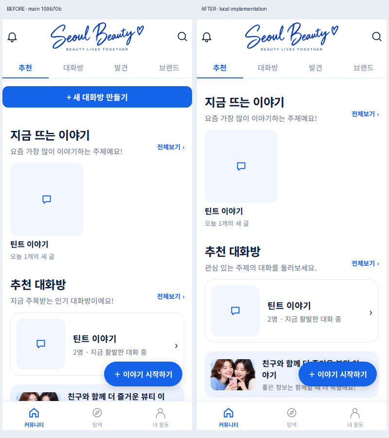
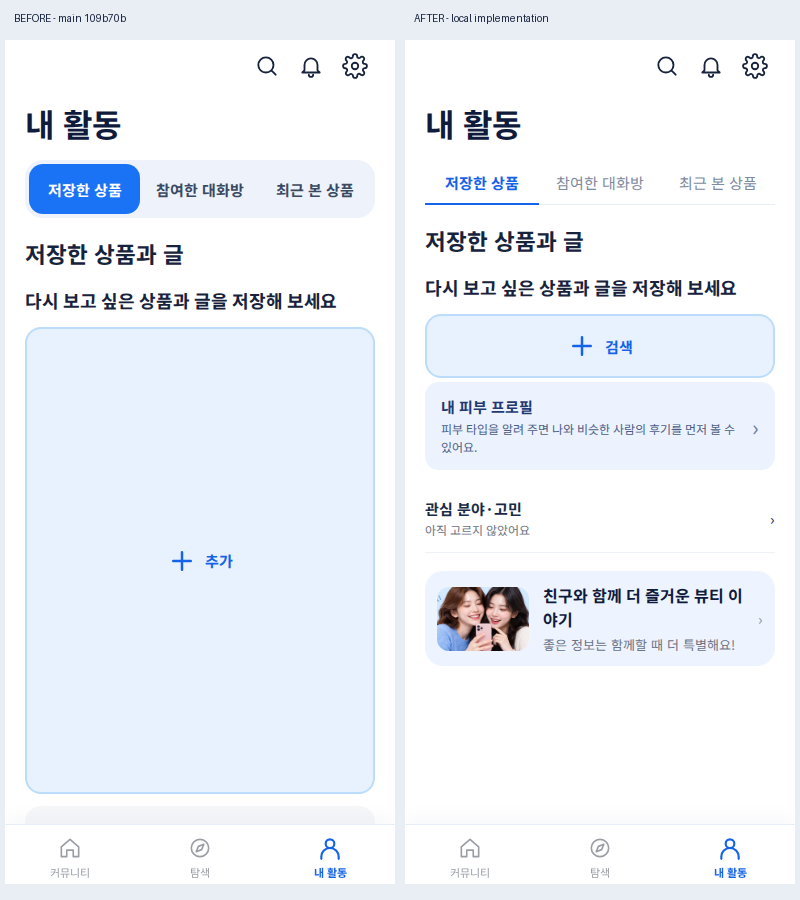
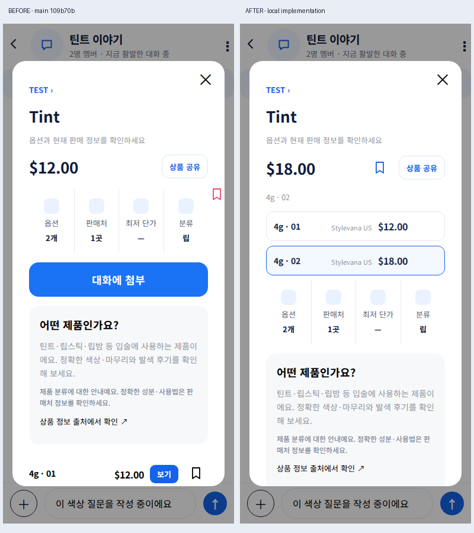

# Seoul Beauty 인계 구현·검증 기록

기준: main `109b70bb037c2f127c2d248a4bfe4d3d592e4b94`, 작업 브랜치 `fix/community-handoff-p0-20261020`, Draft PR #133. 기록일 2026-10-20 KST. **부분 구현·웹 로컬 검증 완료이며 전체 인계 완료나 출시 승인이 아니다.**

## 현행 / 변경 / 검증 / 차단

| 영역 | 현행 문제 | 변경 | 검증·제한 |
|---|---|---|---|
| 커뮤니티 | 생성 버튼 중복, 근거 없는 인기 설명 | 이야기 시작 진입점 하나, 방 생성·기존 방 작성 유지, 중립 문구 | 한국어·영어 모바일 E2E 통과. 방+첫 메시지 원자성은 미구현 |
| 발견 | 카탈로그 상품을 인기 목록으로 노출 | 웹/iOS 대화 속 실제 상품, 없으면 짧은 안내와 방 탐색. 판매처·시장·SKU별 구분 | 웹 E2E·집계 테스트 통과. iOS 실행 미검증; 일부 대화 표본 |
| 상품 | 사진으로 옵션을 구분하여 같은 사진 SKU가 섞임, 중복 저장/구매 | 별도 옵션 선택, 첨부 SKU 유지, 가격·재고·링크·저장 동기화, 주 구매/저장 행동 단순화 | 웹 같은 사진의 01/$12와 02/$18 fixture 검증. iOS 코드 변경은 빌드·실기기 검수 필요 |
| 대화 | 방 이동 시 초안 초기화, 전송 도중 다른 방 응답 혼입 가능 | 웹 메모리 초안 유지, 요청 방 확인, 실패 후 문장/카드 유지, 성공 후에만 chat_send | 실패503→재시도 성공 E2E. 서버 커밋 후 응답 유실의 재전송 중복은 미해결 |
| 읽던 위치 | 새 메시지에 갱신·읽음 처리 | 웹 과거 위치 유지, 새 메시지 이동 버튼, 하단에서만 읽음 처리 | 코드 변경. 실제 다중 사용자·이미지 지연 로딩 미검증; iOS 미구현 |
| 내 활동 | 빈 슬롯3개, 알약형 웹 탭, 큰 빈 버튼 | 저장0개 때 찾기 동작 하나, 저장 후 빈 슬롯 제거, 기존 승인 밑줄 탭 | 390px 캡처·버튼 높이·밑줄 검증. 저장 옵션 재실행 복원 E2E 통과 |
| 상세 빈 상태 | 빈 후기와 관련 대화 반복 | 웹 빈 영역 한 줄, 기존 데이터 있으면 후기 기능 유지 | 웹 회귀 통과 |
| 계측 | 웹 방 진입 누락·family 구매 CTA 미계측 | 진입 성공 후 chat_open, 주 구매 CTA merchant_click, 저장·전송 성공 시점 보강 | fixture 요청 확인. 운영 이벤트 수신/저장 미검증 |
| 관리자 | 수동 기획 지표만 표시 | 기존 권한 경로 안에서 최근7일 행동별 고유기기 진단, 오류 상태 구분 | 서버·브라우저 mock 권한 테스트 통과. 실데이터 연결 미검증 |

## 변경 전후 화면

원본 사용자 참고 파일 IMG_3989.png / IMG_3990.png는 제공받지 못했다. 운영 웹을 직접 확인하고 main 코드를 로컬로 실행해 기준을 확보했다. 아래는 동일한 fixture와 390×844 viewport에서 실행한 **실제 로컬 브라우저 화면**이다. 운영 트래픽·주문·고객 데이터가 아니며 생성 이미지가 아니다. 비교 캡처에만 Noto Sans KR 대체 폰트를 주입해 한글 깨짐을 방지했다. 앱 폰트 자산은 바꾸지 않았다. 상품 사진이 없는 fixture라 사진 영역은 비어 있다.

## 실행한 검증

- `npm test`: **135/135 통과** (기존130 + 관리자 집계/권한4 + SKU 구분1).
- `node e2e/handoff.e2e.mjs http://127.0.0.1:3000/`: 같은 사진 옵션 가격·링크·저장, 실패 초안/첨부, 방 복귀, 재시도 성공 이벤트, 저장 재실행, 빈 버튼 높이·밑줄 통과. CI workflow에 추가.
- `node e2e/community.e2e.mjs ...`: ko/en 홈·상품 언급·원래 대화·상세 복귀·내 활동·모바일 폭 통과.
- `node e2e/offline.e2e.mjs ...`: 온보딩/내 활동/프로필 동의/글·댓글/리뷰/채팅 차단 회귀 통과.
- `node e2e/admin.e2e.mjs`: 익명·일반계정 거부, 관리자 탭/모바일/권한 회수/로그아웃 통과. 인증은 로컬 mock.
- `node e2e/no-tracking.e2e.mjs ...`, `node e2e/brands.e2e.mjs ...`: 저장/복귀/구매 링크, 브랜드 실패·재시도·페이지 분기 통과.
- `node --check dist/app.js`, `node --check dist/chat.js`, `git diff --check`: 통과.
- 브라우저: Chromium, 390×844. iOS Xcode/실기기, 실제 공유 시스템창, 인증/온보딩 딥링크, Dynamic Type, 구매 외부앱 왕복은 실행 미검증.

## KPI 연결 상태

코드 경로는 `dist/events.js` / `ios/Alimi/Events.swift` → Supabase `app_events` (기존 INSERT 권한·이벤트 허용 목록) → 서버 전용 `server/admin-metrics.js` → 기존 관리자 인증 후 `/api/admin?view=metrics` → `/admin`이다. 이번에는 새 DB 마이그레이션이나 권한 변경을 적용하지 않았다.

- 조회 대상은 앱이 사용하는 `mqsnshnlfwsgabrsmqsz`로 고정. 서버의 기존 `SUPABASE_SECRET_KEY`만 사용. 클라이언트에 secret·원문·기기 식별자를 반환하지 않는다.
- 진단은 최근 7×24시간 rolling window, 서버 수신시각 기준. 표시는 KST. 이벤트별 고유 **기기** 수이며 사람 수·순차 퍼널이 아니다. 기존 verify 트래픽 제외. 원본 대화·검색어는 조회하지 않는다.
- 탭 진입 때 조회(1분 이내 재조회 제한), 수동 새로고침 지원. 지속 자동 갱신·실시간 거래 처리는 미구현.
- 1,000행 제한, 전체 건수와 불일치/건수 헤더 없음은 `부분 수신`으로 숫자 비표시. 무연결·권한 오류·조회 실패·미수신을 실제0과 구분한다.
- 실제 주문/승인/취소/반품/정산·수익은 **미연결**. 클릭을 구매로 바꾸어 계산하지 않는다.
- 카드 노출 CTR, 세션/journey 연결, event_id 기반 재전송 중복 제거, 첫 발화/응답/후속 대화, 상호 참여자, D7 코호트, 저장→재열람, 클릭→구매 귀속, 기간/유입/카테고리 필터·드릴다운은 **미구현**. 최근7일 기기 진단으로 이 지표들을 대체하지 않는다.
- 운영 DB 집계 조회는 자동 승인 검토가 거부했다. 연결 프로젝트가 Seoul Beauty와 무관한 프로젝트로 식별됐다는 이유다. 다른 경로로 조회하거나 권한을 바꾸지 않았다. 올바른 Seoul Beauty 프로젝트 연결 및 허용된 운영 검증 경로가 필요하다.

## 미완료·출시 게이트

1. 방 생성+첫 메시지 원자 저장, 서버 idempotency, 응답 유실 후 재시도 중복 방지. 현재 클라이언트의 동시 클릭 차단은 exactly-once 보장이 아니다.
2. iOS 초안/스크롤 복원, 새 메시지 안내, 네이티브 저장 맥락 및 외부 구매 열기 실패 처리 전체 검수. 이번 iOS 변경은 옵션·최근본 SKU·발견 목록·문구 범위다.
3. 모든 공유·삭제/비공개/잘못된 링크, 신규 세션 인증 복귀, 백그라운드·OS 프로세스 종료 시 목적지/초안 보존. 웹 메모리 초안은 새로고침/프로세스 종료를 넘지 않는다.
4. 과거 가격의 최신 재검증, 다중 판매처·시장·세트 변형, 출발 대화 표시/딥링크, 이미지 로딩 중 위치 복원 전체 시나리오.
5. 전체 시작 로딩 지연/오프라인·프로필/설정의 아바타 부재, 작은 iPhone·긴 영문·Dynamic Type 실제 검수. 이번 캡처는 일부 웹 화면만 확인했다.
6. P1 전체 이벤트 스키마·서버 검증/RLS·보존·중복 제거·코호트 집계와 실제 거래 권한/공식 clickref 반환 규칙 확인 후 구현·운영 검증.
7. 열린 PR #123(공유), #124(관리자 KPI)와 충돌·중복 검토. 이번 PR은 이를 병합하지 않았다.
8. main 병합·운영 배포·TestFlight 업로드·Apple 처리·테스터 노출·실기기 설치 모두 이번 작업에서 실행하지 않았다. CI 결과와 출시 단계는 별도다.
