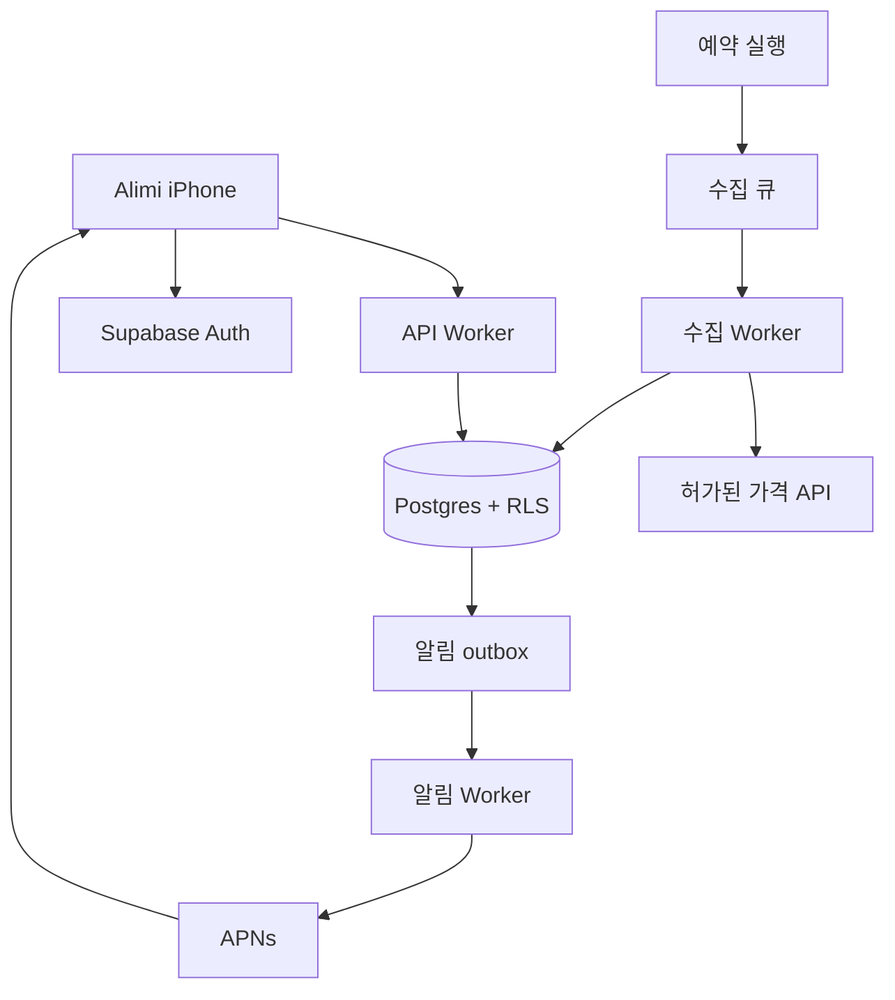

# Alimi iPhone — DAU 1,000 설계 검토

작성: 2026-10-15 KST. 검토 기준: `056c0fa70c3ca07a1c148626b54a6d12c8c73126`.
상태: 설계 제안 + 오프라인 계산 검증. 운영 용량 입증/인프라 구축 완료 아님.

## 1. 이전 검토의 수정

`ce0ec41`은 웹 프로토타입이다. 최신 코드는 `ios/` SwiftUI iPhone 앱이고 UserDefaults에 관심 상품/목표가를 보관한다. `dist/` 웹은 별도 초안이다. 양쪽 모두 실제 수집/인증/DB/푸시가 없다. iOS XCTest 7개는 작성됐으나 Xcode 부재로 미실행. 웹 로직 6개 통과를 iOS 검증으로 사용하지 않는다.

주 서비스는 iPhone이므로 Pages는 필수 런타임이 아니다. 앱 설명/개인정보 페이지나 웹 초안 유지에만 선택 사용한다. 기본 알림은 이메일 대신 APNs를 검토한다. Resend는 이메일 인증/보조 알림을 선택할 때만 필요하다. UI를 재작성하지 않고 AlimiStore 뒤에 데이터 저장소 인터페이스를 도입하는 단계적 연결을 제안한다. 이번 변경에서는 UI/저장소 코드를 수정하지 않았다.

## 2. 용량 가정과 계산

등록 사용자와 DAU는 다르다. 아래 10,000 관심 등록은 '추적 중인 계정도 1,000개'라는 추가 가정이다. 휴면 사용자의 추적이 계속되면 DAU가 그대로여도 수집 대상은 증가한다.

| 지표 | 가정/산식 | 결과 |
|---|---|---|
| DAU | 1,000명 | 동시 1,000명 아님 |
| 추적 계정 / 관심 수 | 1,000 × 10 | 10,000 등록 |
| 고유 오퍼 | 등록 × 20% | 2,000개 |
| 외부 조회 | 2,000 × 4회 | 8,000/일, 240,000/30일 |
| 논리 조회 평균 | 8,000 / 86,400초 | 0.093/초 |
| 앱 API 최소 시나리오 | 1,000 × 5 | 5,000/일, 150,000/월 |
| API 민감도 | 1,000 × 20 | 20,000/일, 600,000/월 |
| 이력 90일 | 8,000 × 90 | 720,000행 |
| 수집 큐 | 오퍼 조회당 메시지 1개, write/read/delete 3회 | 24,000 operations/일, 720,000/월 |

조회 횟수는 논리 오퍼 조회다. 공급자가 배치 API를 지원하면 실제 HTTP 요청은 줄고, 페이지네이션/재시도는 증가한다. 상품 단위 20%인지 오퍼 단위 20%인지 혼동하지 않는다. 한 상품의 판매처 3개를 별도 수집한다면 2,000 상품은 6,000 오퍼다.

고유 비율 20%/50%/100%일 때 수집은 8,000/20,000/40,000회/일이다. 모두를 같은 시각에 호출하지 않고 6시간 슬롯 내에 분산한다. 6시간 주기는 평균 약 3시간, 정상 조건에서 최대 약 6시간의 탐지 지연을 뜻하므로 '실시간'이라고 표시하지 않는다.

API 평균 응답 20KB 가정: 5천 호출/일은 월 3GB, 2만 호출/일은 12GB다. 이미지 트래픽, auth, 작업 API 및 캐시 미스는 별도다. 월 사용자 수는 DAU×30으로 단정하지 않는다. 매일 신규 1천명이라면 한 달 신규 3만 계정과 최대 30만 관심 등록을 별도 모델링한다.

## 3. 최소 구조 제안

웹 요청, 수집, 알림은 별도 실행 경로/한도로 나누되 한 코드 저장소를 유지한다. 1개 상품 단계는 DB 작업 테이블과 소규모 예약 실행으로 시작할 수 있다. 2,000 오퍼 단계에서는 큐/lease/재시도와 수집처별 동시성 제한을 검증한다. 큐 도입 시 아래 비용을 포함한다. 공급자 응답을 기다리는 작업을 사용자 API 안에서 수행하지 않는다.

앱 API 예: 상품 검색, 상품 상세+이력, 내 관심 목록, 목표가 변경, 내 알림함, device token 등록. 검색 debounce/페이지당 20개/이력 기간 제한을 적용한다. 공개 가격 캐시와 개인별 응답을 분리하며 개인 응답은 공유 CDN 캐시에 넣지 않는다. Worker가 사용자 JWT를 검증하고 Supabase 접근 시 JWT를 전달해 RLS를 유지한다. 사용자 경로에 service-role을 사용하는 우회는 피한다.

## 4. 데이터 경계

| 테이블/개념 | 키와 역할 |
|---|---|
| products | 제품/용량/색상/수량 옵션을 구분한 정규 제품 ID |
| offers | 판매처·판매자·외부 오퍼 ID·옵션·국가·통화·가격 조건의 고유 조합 |
| price_observations | offer_id + collection_slot 고유키, 금액 최소 통화단위, 배송비, 재고, observed_at/fetched_at |
| offer_current | 마지막 성공 가격과 마지막 시도 시각을 별도로 유지 |
| watchlists | user_id + 추적 대상 고유키, 목표가, 통화, rule_version, armed |
| notification_events / outbox | watch_id + rule_version 고유키, 상태/시도 횟수/다음 시도/이벤트 ID |
| device_tokens | 소유 사용자, 기기 설치 ID, APNs token, sandbox/production 환경, 유효 상태 |
| collection_jobs | offer_id + slot, lease 만료, 재시도/실패 이유 |

동일 조건의 오퍼만 공유한다. 회원 전용 가격/개인 쿠폰/배송지별 가격은 전 사용자 공통 가격으로 처리하지 않는다. 초기에는 한국/KRW/공개 가격과 명시된 배송 조건 한 종류로 제한한다. 통화가 다르거나 배송비가 불명확하면 최저 총비용으로 단정하지 않는다. 상품 기준 추적이면 같은 조건의 오퍼 최저 총액을 계산하고 가격 근거 offer_id를 이벤트에 기록한다.

Auth 사용자 ID를 소유권 기준으로 사용한다. 모든 노출 테이블 RLS와 명시적 grants를 검토하고 watchlists/device_tokens/알림은 본인만 조회·쓰기 허용한다. UPDATE는 USING과 WITH CHECK로 소유권 이전도 막는다. 수집 결과 쓰기는 서버 전용. publishable key만 앱에, service secret/APNs 키는 서버 비밀 저장소에 둔다. 토큰은 Keychain에 보관하고 로그아웃 시 기기 연결을 끊는다. 계정 삭제/기기 토큰 갱신/거부된 푸시 권한을 검증한다.

## 5. 알림 정책과 장애

초기 정책: 설정된 목표 이하가 처음 관측되면 rule_version당 이벤트 한 번. 이후 더 떨어져도 재발송하지 않고, 사용자가 목표가 변경/재설정하면 새 버전으로 arm한다. 이미 목표 이하에서 등록하면 한 번 즉시 판정한다. 일시적 가격 반등으로 자동 재arm하지 않는다.

가격 저장/규칙 상태 변경/outbox 생성은 DB 트랜잭션으로 원자화하고 UNIQUE 제약으로 동시 실행을 방어한다. 큐는 at-least-once이므로 재전달을 정상 상황으로 취급한다. APNs 수락 직후 DB 갱신 전에 장애가 나면 재발송 가능성이 있다. DB 이벤트 중복 억제와 OS 표시 exactly-once 보장은 다르다. 안정적인 event_id, collapse ID, 앱 알림함 중복 제거로 완화하되 '푸시가 반드시 한 번만 표시된다'고 약속하지 않는다. APNs 수락도 실제 기기 도착 보장이 아니다.

429는 Retry-After, 일시 장애는 지수 backoff+jitter, 최대 횟수 이후 실패 큐로 보낸다. 인증/영구 오류는 무한 재시도하지 않는다. 오래된 수집 결과가 최신 가격을 덮지 않도록 source time/slot을 비교한다. 재고 없음/잘못된 통화/극단 가격/파싱 실패는 격리한다. 실패를 0원으로 저장하지 않는다. 마지막 성공 시각과 가격 만료 상태를 화면에 표시하며, 만료 가격으로 신규 알림을 발송하지 않는다. 6시간 수집 기준 stale 경계 8시간은 제안값이며 UI 승인 후 결정한다.

## 6. DB와 비용 예산 — 추정, USD

관측행+인덱스를 합쳐 200~600바이트/행으로 가정하면 90일 144~432MB. 계정/오퍼/관심 목록/작업 기록 50MB 가정 추가 시 194~482MB. 이는 실측 크기가 아니며 시스템 카탈로그, bloat, 운영 여유, 로그/백업 저장은 추가다. 무료 500MB에 안전하게 들어간다고 결론내릴 수 없다. 1년 원시 이력은 약 584MB~1.752GB다. 90일 원시 이력 후 일별 요약을 제안하되 삭제 전 보존 요구를 확정한다. 불변 가격은 변경 이벤트만 저장하더라도 마지막 성공 조회 기록을 별도 유지한다.

| 항목 | 공식 기준 확인 | 이 시나리오 계획 |
|---|---|---|
| Pages | 앱 화면 실행에 불필요 | 선택, 기본 예산 제외 |
| Workers | Free 100,000 요청/일; Paid $5/월부터, 요청/CPU 포함량 및 초과 요금 | 운영 기본 $5, CPU 실측 필요 |
| Queues | Free 10,000 operations/일; Paid 월 100만 포함 후 $0.40/백만 | 수집만 24,000/일로 무료 초과; paid 포함량 내 추정 |
| Supabase | Free 500MB/50,000 MAU/5GB egress; Pro $25/월부터, 8GB disk/100,000 MAU/250GB egress | 단일 Micro 프로젝트 $25 기준, 별도 staging/증설은 추가 |
| Apple Developer Program | 연 $99 또는 지역 통화 | 월 환산 $8.25, 실제 연간 결제 |
| APNs 처리 | 전송 Worker/큐 비용은 위 실행 비용에 포함 | 직접 APNs 사용 가정; 외부 푸시 SaaS 비용 제외 |
| 이메일 | iPhone 가격 알림의 기본 채널 아님 | 선택 전 미산정; 인증 이메일을 쓰면 SMTP 공급자 비용 추가 |
| 가격 데이터/API·이미지·도메인·세금 | 공급자/권리/캐시 조건 미확정 | 미산정, $0으로 간주하지 않음 |

운영 기초 예산은 Workers $5 + Supabase $25 = 월 $30부터. Apple 연회비 월 환산 포함 약 $38.25부터. 외부 데이터/SMTP/추가 환경/초과 사용료 제외이므로 총비용 상한이 아니다. 무료 실험은 가능하나 제안된 큐 구조 전체를 무료로 유지할 수 있다고 주장하지 않는다.

알림 발생률은 관심 규칙 10,000개 중 하루 1%면 100건/일, 10%면 1,000건/일. 기기 1개/이벤트 가정에서 월 3,000~30,000 전송. 각 전송을 큐로 처리하면 9,000~90,000 operations/월이 더해져 수집과 합계 729,000~810,000; 재시도/추가 판정 큐/64KB 초과 메시지는 추가다. 큐 작업 수와 Worker invocation 수는 같지 않으며 배치 크기로 달라진다.

예산 경고: 계획 사용량 50/80/100%에서 알림, provider 호출에 별도 일일 hard cap, 실패 재시도 예산을 분리. 사업자 spend cap이 모든 비용을 차단한다고 가정하지 않는다.

## 7. 기능 단위 검증 게이트

| 단계 | 입력/부하 | 통과 기준(제안) | 현재 |
|---|---|---|---|
| M0 iPhone | iPhone 시뮬레이터+실기기 F1–F5 | 검색/상세/관심 영속성/목표가/재실행 모두 정상 | 미실행 |
| M1 인증·격리 | A/B 계정 + 비로그인 CRUD 및 소유권 변조 | 다른 사용자 레코드 노출/수정 0건, 토큰 만료/삭제 처리 | 미구현 |
| M2 실제 1오퍼 | 허가 API 4회/일 × 7일=28회 | 수집·저장·가격/시각/통화 일치, 실패 원인 전부 기록 | 미실행 |
| M3 알림 1규칙 | 동일/하락/반등/재설정/재시도/장애 주입 | 규칙당 이벤트 1개, 명시 재arm만 새 이벤트; APNs 수락/기기도착 구분 | 오프라인 정책 모델만 확인 |
| M4 100→1,000→2,000오퍼 | 공급자 허용량 내 단계별 슬롯 | 7일간 슬롯 마감 내 성공 ≥99%, 0원/오래된 가격 알림 0건 | 미실행 |
| M5 100명 동시 활성 | 아래 staging 계획 | p95≤500ms, 오류율<1%, 사용자 격리 0건 위반 | 미실행 |
| M6 복구 | 큐 재전달·DB 중단·worker 종료·백업 복원 | 이벤트 유실 없음, 복원 건수/시간 기록 | 미실행 |

28회 표본은 99% 신뢰성 입증이 아니다. 수집 성공률 분모는 예정된 슬롯 전체, 분자는 정해진 시간 내 유효 저장 성공이며 retry 횟수로 분모를 늘리지 않는다.

부하 계획: 승인된 격리 staging만 대상으로 10→25→50→100 VU, 각 5분, 100 VU 15분 유지. 사용자당 5초 간격 평균 1 API면 약 20 RPS; 짧은 100 RPS burst 별도. 읽기 80%/쓰기 20%, 상품 상세/이력/검색/관심 목록을 혼합하고 합성 계정 1천개·오퍼 2천개·이력 72만행을 사용한다. 실제 판매처와 APNs는 mock 처리. 캐시 cold/warm 및 queue 작업 동시 수행을 분리한다. 1분 오류율>5%, DB 연결 포화 또는 승인 예산 초과 시 중단한다. HTTP p50/p95/p99, DB query/lock/CPU, egress, 큐 지연, 오류율과 버전·리전·테스트 시간을 기록한다. 사용자 API 목표는 공급자 외부 수집 지연과 별개다.

## 8. 실제 수행과 다음 단계

`scripts/capacity-review.mjs`를 로컬 실행해 산술·동일 오퍼 작업 중복 제거·규칙 버전별 이벤트·명시 재arm의 4개 assertion 그룹을 통과했다. 결과: `capacity-model-results.json`. 이것은 메모리 내 정책 모델이며 구현될 DB의 동시성/중복 발송/부하/RLS를 검증한 것이 아니다. 기존 웹 단위 테스트 6개 재실행 통과. iOS 테스트/성능/실제 가격/푸시는 미실행.

새 인프라, 외부 수집, 비용 발생 작업, DB 변경은 수행하지 않았다. 다음은 iPhone F1–F5 실기기 검증 → 인증/DB 한 계정 흐름 → 허가된 상품 1개 수집 → APNs 한 기기 → 오퍼 규모 확대 순서다. 가격 공급자 선정 시 API 이용 권한, 가격/이력 보존·재표시·이미지·제휴 사용 조건, 호출량과 비용을 서면 확인한다. 공개 웹에서 읽을 수 있다는 사실을 재사용 허가로 간주하지 않는다.

## 공식 근거 (2026-10-15 열람)

- https://supabase.com/pricing
- https://supabase.com/docs/guides/database/postgres/row-level-security
- https://supabase.com/changelog — markdown endpoint 조회 실패 후 HTML 확인. 이번에는 SDK/DB 변경 없음. 실제 구현 직전에 관련 breaking changes 재검토.
- https://developers.cloudflare.com/workers/platform/pricing/
- https://developers.cloudflare.com/queues/platform/pricing/
- https://developers.cloudflare.com/queues/reference/delivery-guarantees/
- https://developer.apple.com/help/account/membership/program-enrollment/
- https://developer.apple.com/documentation/usernotifications/sending-notification-requests-to-apns
