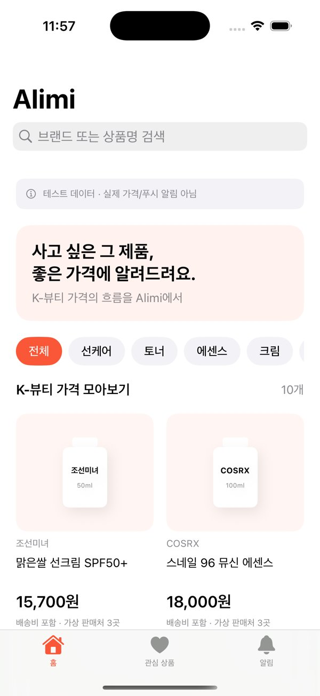

# Alimi iOS 빌드 검증 — 2026-10-15 KST

검증 커밋: 6e833c736cb9860d41253f52d4e1dba3d751d2d6
실행: https://github.com/yohan4477/Alimi/actions/runs/38657001190

- macOS GitHub runner / Xcode 16.4
- iPhone 16 Pro Simulator / iOS 18.5
- XcodeGen 프로젝트 생성: 성공
- 앱 빌드: 성공
- XCTest: 7개 실행, 실패 0개
- F1 검색, F2 상품별 이력, F3 배송비 포함 최저가, F4 관심 등록, F5 목표가 시뮬레이션, 입력 검증, 영속성 테스트 통과
- 시뮬레이터 앱 설치/실행: 성공
- 홈 화면 캡처: 성공, 캡처 직접 확인
- 화면을 누르는 XCUITest / 실제 iPhone / APNs / TestFlight: 미검증

이미지는 원본 시뮬레이터 PNG를 축소한 JPEG입니다. 홈 렌더링 확인은 전체 F1–F5 UI 조작 테스트를 대체하지 않습니다.

Actions artifact에는 원본 PNG, xcodebuild 로그, xcresult, 시뮬레이터용 .app ZIP이 있습니다. 보관기간 3일. 시뮬레이터용 .app은 실제 아이폰에 설치할 수 있는 IPA가 아닙니다.

워크플로는 workflow_dispatch 또는 워크플로 파일 변경 시 실행됩니다. 일반 소스 커밋마다 자동 과금 실행하지 않습니다. 실행별 20분 상한, 중복 실행 취소. 다시 실행할 때는 Actions의 Run workflow를 사용합니다.
