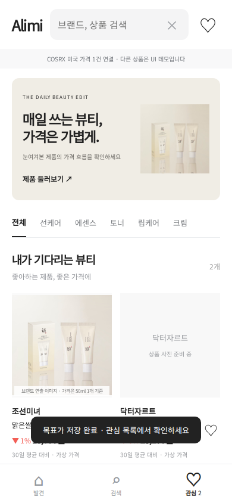
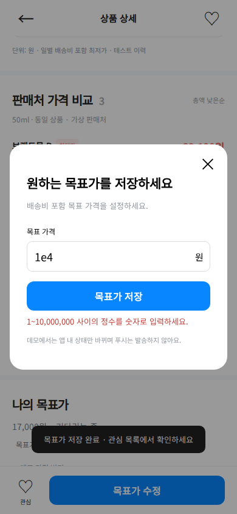

# Alimi 모바일 웹 사용자 흐름 브라우저 검증 — 2026-10-17 KST

관련: PR #33, 후속 #34/#35; ALM-F1/F2/F4/F5 (#3/#4/#6/#7). 사용자의 이번 검증·결함 수정 요청을 실행 근거로 삼는다. 기존 카드·히어로·상세·판매처·하단 버튼 디자인을 유지했다. 가격 관측·수집·제휴·푸시 코드는 이 변경의 대상이 아니다.

## 대상과 환경

- 원본 PR #33: `247557e6b60fe00645baf82fbf2ce8c652ee9cce`.
- 수정 후 대상: 이 문서를 포함한 PR #33 커밋의 `dist/app.js`, `dist/index.html`, `dist/style.css`. [실행 결과 JSON](mobile-flow-2026-10-17/pr33-results.json)에 실제 실행 시각·소스 SHA-256을 기록했다.
- Linux / Node v24.19.0 / Playwright 1.62.1 / Chromium 153.0.8010.0, headless.
- 화면: 320×844, 390×844, 430×844 CSS px. 각 화면에 별도 브라우저 컨텍스트, `isMobile: true`, `hasTouch: true`, 실제 Playwright `tap()` 사용. 기본 DPR 1; 특정 iPhone 모델로 가장하지 않았다.
- Linux에 한글 시스템 폰트가 없어 테스트에서만 Noto Sans KR 400을 기존 Apple SD Gothic Neo 폰트의 대체로 등록했다. 앱의 폰트·레이아웃 CSS는 교체하지 않았다. iOS 타이포그래피의 픽셀 일치는 검증하지 않았다.
- 표본: 카탈로그 10개, COSRX USD 목표가와 원화 데모 목표가. 네트워크 가격 수집 없이 저장소와 UI 동작을 검사했다.

기본 Playwright Chromium 다운로드는 ZIP 손상으로 실패했다. npm의 `@sparticuz/chromium@153.0.0` 공식 패키지에 포함된 바이너리를 풀어 실제 Chromium 프로세스를 실행했다. 클라우드 브라우저에서는 로컬 HTTP 서버가 연결 거부되어 사용하지 않았다. 이 실패 경로를 테스트 통과로 세지 않는다.

## 재현한 결함과 수정

| 결함 | 원본 재현 결과 | 수정 |
|---|---|---|
| 목표가 저장 후 초점 손실 | 상세 DOM을 다시 그려 `activeElement`가 body가 됨 | 저장 완료 후 새 목표가 수정 버튼에 `preventScroll`로 초점 복원 |
| 숫자 입력을 설명 없이 무시 | 원화 `1e4`는 number 입력의 브라우저 유효성은 통과하지만 앱 정규식에서 조용히 거부 | 모달 안에 통화별 오류·`role=alert`·`aria-invalid`·`aria-describedby` 추가. min/max/step 위반도 같은 안내 사용 |
| 초기화 저장 실패 무안내 | setItem 예외 후 화면만 비워지고 안내 없음 | 저장 결과에 따라 성공 또는 현재 화면에서만 초기화됨을 안내 |

[원본 실행 결과](mobile-flow-2026-10-17/baseline-results.json): 13개 시나리오 × 3개 화면 = 39개 중 30개 통과, 위 결함 각각 3개 화면에서 실패해 총 9개 실패. 이후 USD 경계·키보드 속성과 하트 해제/목표가 유지 검사 2개씩을 추가했다. 원본에 추가 6개를 실행했다고 주장하지 않는다.

## 수정 후 UI 결과

각 행을 세 화면 모두에서 실행: 15개 × 3 = **45/45 통과**. [원시 결과](mobile-flow-2026-10-17/pr33-results.json).

| 시나리오 | 실제 결과 |
|---|---|
| 발견 화면·터치 환경·가로 넘침 | 상품 10개, 터치 포인트 존재, 초기 화면 가로 넘침 없음 |
| 하트 저장 + USD 목표가만 저장 | 두 상품 모두 관심 목록에 표시 |
| 검색 결과 없음 + 크림 카테고리 → 관심 | 검색어와 카테고리 초기화, 저장 상품 표시 |
| USD 15.25 저장·새로고침·14.50 수정 | 저장값 유지, 수정값 반영 |
| USD decimal 입력 모드·10,000.01 입력 | decimal 속성 확인, 범위 오류를 모달 안에 표시 |
| COSRX 하트 추가·해제 | 하트가 없어도 목표가가 있으면 관심 목록에 유지 |
| 모달 취소 | 기존 목표가 버튼으로 초점 복귀 |
| USD 목표가 삭제·새로고침 | 목표가와 목표가만 저장한 상품이 관심 목록에서 제거 |
| 원화 12,000 저장·11,000 수정·재방문·삭제 | 값 유지 및 삭제 반영, 하트로 저장한 상품은 유지 |
| 상세 → 화면 내 뒤로 | 목록 스크롤 차이 3px 미만, 원래 상품 버튼에 초점 |
| 상세를 아래로 내린 뒤 목표가 저장 | 상세 스크롤 차이 3px 미만 |
| 목표가 저장 후 초점 | 새 목표가 수정 버튼으로 복원 |
| 원화 1e4 입력 | 모달 유지, 접근성 속성과 오류 설명 표시 |
| 원화 numeric 입력 모드·16px 이상·0 입력 | 속성과 크기 확인, 잘못된 값 저장 차단 |
| 브라우저 오류·저장소 차단·초기화 실패 | uncaught 오류 없음. setItem/removeItem 강제 예외 환경에서 저장 성공을 표시하지 않고 새로고침 후 미저장 확인. 초기화 실패 안내 확인 |

저장소 차단 테스트는 테스트 컨텍스트의 Storage 메서드에만 예외를 주입한다. 실제 사용자 데이터를 지우거나 브라우저 설정을 바꾸지 않았다.

기존 Node 테스트 **12/12 통과**, `node --check dist/app.js`, `node --check scripts/mobile-flow.cjs` 통과. [단위 테스트 로그](mobile-flow-2026-10-17/unit.log). 이 숫자를 모바일 UI 45개와 섞지 않는다.





## 후속 PR 및 main 충돌

확인한 main은 `c7fd442c5daaa24c3999230579095ecf88d6880c`이며 공식 Stylevana 피드 연동 #36, 이력 저장 #37, 검증 기록 #38이 이미 들어 있다. 따라서 이 작업의 PR 브랜치만 보고 현재 main의 가격 공급 상태를 판단해서는 안 된다.

| 대상 | 확인 결과 | 병합 전에 필요한 작업 |
|---|---|---|
| #33 → main | GitHub mergeable=false. 공통 조상 `4b86340294c6ae145719da74cc3ed36b07ba12c9` 기준 3-way 검사에서 `dist/app.js`, `docs/PRODUCT_STATUS.md` 충돌 재현 | main의 공식 피드 import·이미지·sourceLabel·갱신 시각·상태 기록과 #33의 저장 흐름·이번 수정을 함께 보존해 해결. 해결본은 아직 브라우저 미검증 |
| #34 → 수정 #33 | #34 head `cde9ba785c8948a1653b27de98f5bdf7b0288c51`. 기존 #33을 조상으로 앱 및 현황 문서 3-way 통합은 충돌 없음 | #33이 main과 조정된 뒤 다시 기반을 반영하고 비교 렌더러가 공식 피드의 출처를 수동 관측으로 잘못 표기하지 않는지 재검사 |
| #35 → #34 | #35 head `7929fafdb68b0ef1c9c697c8948fa7d7529dbf40`, Draft. 검증 데이터·문서·mjs 테스트 3개 추가이며 수정 #33 파일과 경로 중복 없음 | #34 기반 갱신 후 테스트 재실행, Draft 해제 여부는 별도 판단 |

로컬에 수정 #33 + #34 + #35를 통합한 사본에서 **모바일 UI 45/45**, Node **30/30** 통과했다. [통합 UI 결과](mobile-flow-2026-10-17/stack-results.json), [Node 로그](mobile-flow-2026-10-17/stack-unit.log). 이는 **현재 main과 충돌을 해결한 최종 병합본의 테스트가 아니다**. 원격 후속 브랜치나 base를 변경하지 않았다.

순서: **#33의 main 충돌 해결·재검증 → #33 병합 → #34 기반 갱신·main으로 대상 변경·재검증·병합 → #35 기반 갱신·main으로 대상 변경·검토·병합**. main 병합·배포는 실행하지 않았다. merge commit으로 조상을 보존하면 스택 관리가 쉽다. squash를 쓰면 후속 브랜치를 새 main 위에 재배치해 앞 PR의 변경이 중복되지 않게 확인해야 한다.

## 가격 데이터와 UI 검증의 경계

#35의 저장된 판매처 관측을 기존 비교 함수로 **재실행**한 테스트 1개는 별도로 통과했다(위 Node 30개에 포함). 다섯 판매처 모두 총액 비교에서 제외되고 최저가가 생성되지 않았다. 현재 판매처를 새로 열거나 결제총액·배송·재고·제형 동일성·제휴 승인 상태를 재검증한 것이 아니다. 원화 가격은 합성 데모이며 모바일 UI 통과가 실제 가격 정확성의 증거가 되지 않는다.

## 미실행 및 한계

- **실제 iPhone, iOS Safari/WebKit, iOS 네이티브 앱: 미실행.**
- 실제 소프트 키보드의 표시·닫힘·키 배치, iPhone 자동 확대, 키보드가 버튼을 가리는지, notch/safe-area, Safari 주소창 축소, 실제 손가락 사용성: 미실행. `inputmode`와 CSS·터치 이벤트 에뮬레이션 검사는 이를 대신하지 않는다.
- 화면 내 뒤로 버튼을 검사했다. 브라우저의 뒤로/앞으로 및 iPhone 가장자리 스와이프는 검사하지 않았다.
- 계정/다른 기기 동기화, 푸시 수신, 자동 가격 감시, 실구매·운영 배포: 미실행.

기능 상태는 구현 PR/검증 중을 유지한다. iPhone 검증 완료·출시로 올리지 않는다.

## 재실행

```sh
npm ci
npx playwright install chromium
npm test
npm run test:mobile
```

이미 실행 가능한 Chromium이 있으면 `CHROMIUM_EXECUTABLE_PATH=/absolute/path/to/chromium npm run test:mobile`. 결과·스크린샷은 기본 `mobile-results/`, 다른 위치는 `MOBILE_RESULTS_DIR`로 지정한다. 이 실행에서처럼 한글 폰트가 없는 Linux는 `MOBILE_FONT_CSS=/absolute/path/to/@fontsource/noto-sans-kr/400.css`를 테스트에만 제공할 수 있다. 브라우저 설치 실패나 실행 실패는 통과로 처리하지 않는다.

롤백: 이번 커밋의 변경만 되돌린다. 기존 관심/원화/USD 저장 키와 형식은 바꾸지 않았다.
